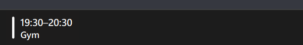

# cal-widget

Your current or next Google Calendar event, on the left side of the Windows 11 taskbar — in the
style of an iOS lock-screen widget.



- **Lives inside the taskbar**: it is not a floating window, so it doesn't cover anything.
- Shows the **event happening now**, or else the **next one today**, or else **tomorrow's first**
  (`Tomorrow · 09:00–10:00`), or **No events**.
- All-day, cancelled and declined events are ignored.
- **Click** to open the event in Google Calendar; **hover** for details; **right-click** for a menu.
- Keeps working **offline** with the last events it saw (shown dimmed), and catches up after sleep.
- Read-only access to your calendar (`calendar.readonly`); your sign-in never leaves your PC.

## Install

1. Download `cal-widget.exe` from the [latest release](https://github.com/zblt03/cal-widget/releases/latest).
   No installation and no Python needed — it is a single file. Put it anywhere, e.g. `C:\Apps\cal-widget\`.
2. Create your own Google OAuth client (`credentials.json`), as explained in
   [Google Cloud setup](#google-cloud-setup) below. This takes about 5 minutes and is only done once.
3. Put `credentials.json` **next to `cal-widget.exe`** (or in `%LOCALAPPDATA%\cal-widget\`).
4. Run `cal-widget.exe`. Click the widget (**Sign in to Google**) and allow access in your browser.
5. Right-click the widget → **Start with Windows** so it starts when you sign in.

> Windows SmartScreen may warn that the app is unrecognised, because the exe is not code-signed.
> Choose **More info → Run anyway**. You can also build the exe yourself (see below).

## Google Cloud setup

Google requires every app that reads a calendar to have an OAuth client. Because this is an
open-source app with no server, each user creates their own (free):

1. Open the [Google Cloud console](https://console.cloud.google.com/) and create a **new project**
   (e.g. "cal-widget").
2. Go to **APIs & Services → Library**, search for **Google Calendar API** and click **Enable**.
3. Go to **Google Auth Platform** (APIs & Services → OAuth consent screen) and click **Get started**:
   - App name: `cal-widget`; support email: your address.
   - Audience: **External**.
   - Contact information: your address. Agree to the policy and **Create**.
4. In **Audience**, under **Test users**, click **Add users** and add your own Google address.
5. In **Clients**, click **Create client** → Application type **Desktop app** → **Create**.
6. Click **Download JSON** and save the file as **`credentials.json`** (see step 3 of [Install](#install)).

> **Signed out after 7 days?** While the app's publishing status is *Testing*, Google expires the
> sign-in after a week. To avoid that, go to **Audience → Publish app**. You do not need Google's
> verification for personal use: at sign-in you will see "Google hasn't verified this app" —
> click **Advanced → Go to cal-widget (unsafe)**. It is your own client, so this is expected.

## Using it

| Action | What happens |
|---|---|
| Click | Opens the shown event in Google Calendar (or starts sign-in if needed) |
| Hover | Tooltip with the full title, time, calendar name |
| Right-click → Refresh now | Fetches events immediately |
| Right-click → Open Google Calendar | Opens calendar.google.com |
| Right-click → Start with Windows | Toggles starting at sign-in |
| Right-click → Quit | Closes the widget |

The shown event updates on time by itself (checked every 30 seconds); events are downloaded from
Google every 5 minutes, when the network comes back and after waking from sleep.

## Settings

Settings are in `%LOCALAPPDATA%\cal-widget\config.json`, created on first run. Edit it with any
text editor; changes apply at the next refresh (or right-click → **Refresh now**).

```json
{
  "refresh_minutes": 5,
  "show_tomorrow": true,
  "bar_uses_calendar_color": false,
  "max_title_chars": 40,
  "excluded_calendars": []
}
```

| Setting | Meaning | Default |
|---|---|---|
| `refresh_minutes` | How often to download events (1–120) | `5` |
| `show_tomorrow` | Show tomorrow's first event when today is done | `true` |
| `bar_uses_calendar_color` | Colour the bar like the event's calendar instead of white | `false` |
| `max_title_chars` | Longer titles are cut with "…" (5–200); the tooltip shows the full title | `40` |
| `excluded_calendars` | Calendars to ignore, by name or ID, e.g. `["Holidays in Spain"]` | `[]` |

An invalid value falls back to its default; the reason is written to the log.

## Files

Everything the app writes lives in `%LOCALAPPDATA%\cal-widget\` (paste it into Explorer's address bar):

| File | Contents |
|---|---|
| `token.json` | Your Google sign-in. Delete it to sign out. |
| `events.cache.json` | The last downloaded events, for offline use |
| `config.json` | Settings (above) |
| `cal-widget.log` | Log for troubleshooting (never contains your sign-in token) |

To uninstall: right-click → untick **Start with Windows**, quit, then delete the exe and this
folder. You can also remove access at [myaccount.google.com/permissions](https://myaccount.google.com/permissions).

## Troubleshooting

| Problem | Fix |
|---|---|
| Widget says **Setup needed** | `credentials.json` was not found — click the widget to open [Google Cloud setup](#google-cloud-setup) |
| Widget says **Sign in to Google** | Click it. If it happens every week, publish the app (see the note above) |
| **Access blocked** / "has not completed the Google verification process" | Add your address as a **Test user** (setup step 4) |
| Widget is dimmed | No connection: it is showing saved events; it recovers automatically |
| Widget is not visible, or overlaps the Windows Widgets (weather) button | Turn off *Settings → Personalization → Taskbar → Widgets*. As a fallback, run `cal-widget.exe --overlay` to float it over the taskbar |
| Taskbar icons are aligned to the left | The widget is designed for the default centred layout (*Settings → Personalization → Taskbar → Taskbar behaviours → Alignment: Center*) |
| Anything else | Look at `%LOCALAPPDATA%\cal-widget\cal-widget.log` and [open an issue](https://github.com/zblt03/cal-widget/issues) |

Known limitations: primary monitor only, taskbar at the bottom, and the light-theme taskbar colour
is approximate.

## Run from source

Requires Python 3.14 on Windows 11.

```powershell
git clone https://github.com/zblt03/cal-widget.git
cd cal-widget
python -m venv .venv
.venv\Scripts\python -m pip install -r requirements.txt
.venv\Scripts\python -m pip install -e .
# put credentials.json in the project folder, then:
.venv\Scripts\python -m cal_widget          # the widget
.venv\Scripts\python -m cal_widget --dump   # print upcoming events in the console, no UI
.venv\Scripts\python -m pytest              # tests
.venv\Scripts\python tools\build_exe.py     # build dist\cal-widget.exe
```

### How it is built

| Module | Role |
|---|---|
| `events.py` | Pure logic: which event to show (`select_event`) — no I/O, fully tested |
| `calendar_client.py` | Google Calendar API calls and the offline cache |
| `auth.py` | OAuth sign-in and token storage |
| `config.py` | Loading and validating `config.json` |
| `taskbar.py` | Win32 (ctypes): finding the taskbar and embedding the widget in it |
| `ui.py` | The PySide6 widget: drawing only, emits signals |
| `app.py` | Controller: state, background fetching, timers |
| `startup.py`, `single_instance.py`, `paths.py` | Start with Windows, one instance only, file locations |

The widget is made a child window of the taskbar (`SetParent` into `Shell_TrayWnd`) and painted
with a colour key, because Qt's per-pixel transparency stops repainting inside the taskbar.

### Releasing

Bump `__version__` in `src/cal_widget/__init__.py`, commit, then push a matching tag:

```powershell
git tag v0.1.1
git push origin v0.1.1
```

GitHub Actions runs the tests, builds the exe and publishes the release.

## License

[MIT](LICENSE) © Nacho
